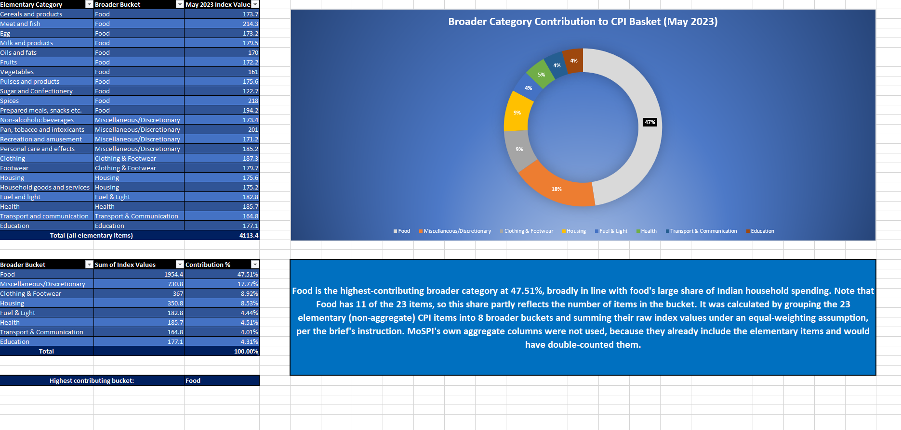
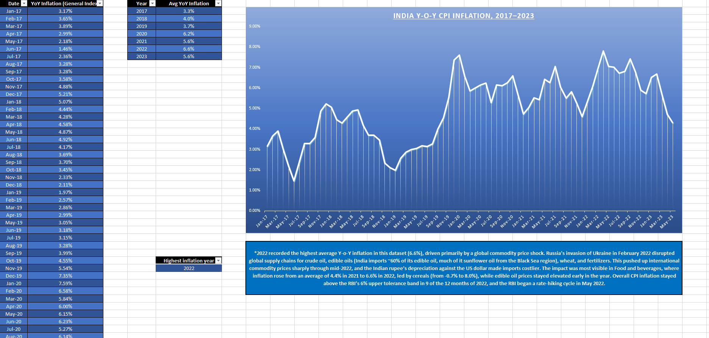
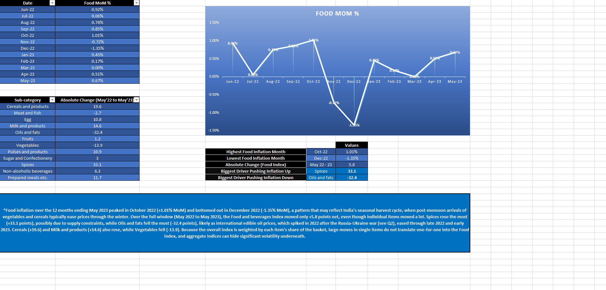
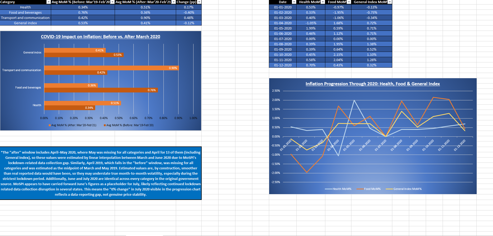
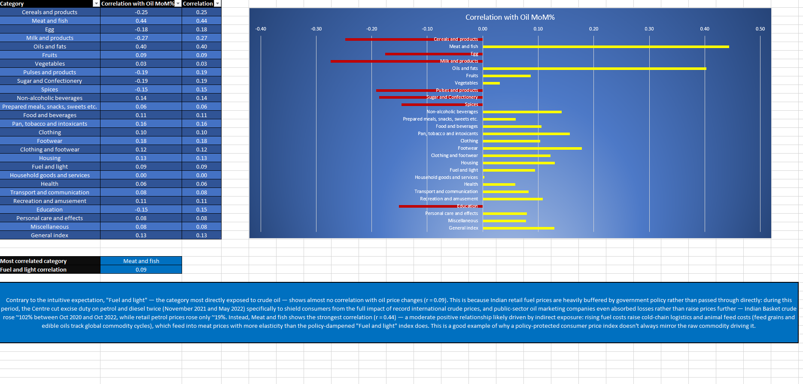

# India CPI Inflation Analysis – Excel Case Study

An Excel analysis of India's Consumer Price Index (CPI) from **Jan 2013 to May 2023** that answers five business questions: what drives the CPI basket, how inflation moved over time, what happened to food prices, how COVID-19 changed inflation, and whether oil prices affect consumer prices.

> Project completed as part of my Data Analytics course (Coding Ninjas × IITM Pravartak).

## Data

| Dataset | Details |
|---------|---------|
| India CPI (MoSPI) | Monthly index values, all-India (Rural + Urban), 125 months, 27 categories (23 elementary items + 4 aggregates incl. General Index) |
| Brent crude oil | Monthly average price ($/barrel), Jan 2021 – May 2023 |

## Questions, Findings and Charts

### Q1. Which broader category contributes most to the CPI basket? (May 2023)

- The 23 elementary items were grouped into 8 broader buckets and their index values summed (equal weighting).
- **Food is the largest bucket at 47.5%**, followed by Miscellaneous/Discretionary (17.8%), Clothing & Footwear (8.9%) and Housing (8.5%).

### Q2. How has overall inflation moved from 2017 to 2023?

- Average year-on-year inflation: **3.3% (2017) → 4.0% → 3.7% → 6.2% (2020) → 5.6% → 6.6% (2022) → 5.6% (2023, Jan–May)**.
- **2022 was the highest year**; the monthly peak was **7.8% in April 2022**. Inflation was above the RBI's 6% upper band in 9 of 12 months of 2022.

### Q3. What drove food inflation in the last 12 months?

- Food prices rose fastest in **Oct 2022 (+1.01% month-on-month)** and fell most in **Dec 2022 (−1.35%)**.
- Food index moved only **+5.8 points** (May 2022 → May 2023), but individual items swung widely: **Spices +33.1** and **Oils and fats −32.4**.

### Q4. How did COVID-19 change inflation? (Mar 2019–Feb 2020 vs Mar 2020–Feb 2021)


| Category | Avg monthly change – before | Avg monthly change – after | Change |
|----------|:-:|:-:|:-:|
| Transport & communication | 0.42% | 0.90% | **+0.48 pp** |
| Health | 0.34% | 0.51% | +0.17 pp |
| General index | 0.53% | 0.41% | −0.12 pp |
| Food & beverages | 0.76% | 0.36% | **−0.40 pp** |

### Q5. Do oil prices move consumer prices? (Feb 2021 – May 2023)

- Correlation of each category's monthly change with Brent oil's monthly change.
- Strongest: **Meat and fish (0.44)** and **Oils and fats (0.40)**.
- **Fuel and light shows almost no link (0.09)**, which is consistent with government-managed retail fuel prices.

## How It Was Built
- **Data preparation:** separate sheets for `Cleaned Data` → `Imputed Data` → `MoM % Change` → `YoY % Change`.
- **Missing values:** 67 blank cells (April 2019, and April–May 2020) were filled by linear interpolation.
- **Analysis:** Excel Tables with `SUMIF`, `AVERAGEIFS`, `AVERAGE`, `CORREL`, `INDEX/MATCH` and `SUBTOTAL`.
- **Charts:** donut, line and bar charts, one sheet per question (`Q1` to `Q5`).

**Tools:** Microsoft Excel

## Data Notes and Limitations
- **Q1** uses an equal-weighted sum of index values, not the official CPI weights. Food has 11 of the 23 items, so its share partly reflects the number of items.
- **April 2019 and April–May 2020** are interpolated values, not reported data.
- **June and July 2020** are identical in the source data, so July 2020 shows 0% monthly change and a dip in yearly inflation. This is a reporting gap, not real price stability.
- **2023** covers only January–May.
- **Q5** uses same-month correlations on 28 data points. It shows association, not cause. The first six oil prices (Jan–Jun 2021) are approximate.

## Files

```
├── README.md
├── India_CPI_Inflation_Case_Study.xlsx   # Full workbook with all formulas and charts
└── images/                               # Screenshots of each analysis sheet
```

## Author

**Shayantan Mitra** – Data Reporting & Operations Analyst
[LinkedIn](https://www.linkedin.com/in/shayantanmitra96) · [GitHub](https://github.com/Dairanji)
